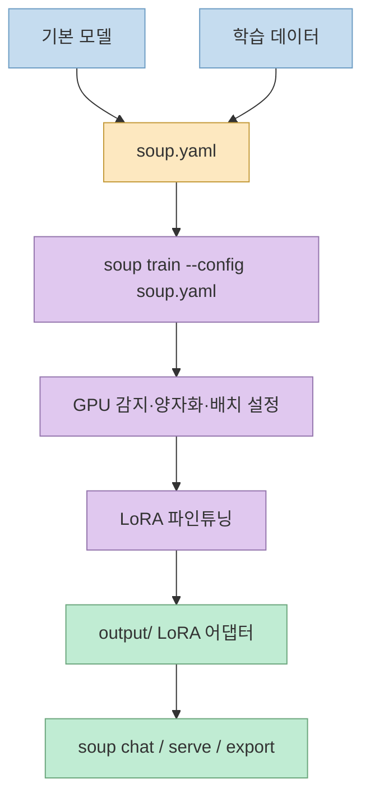
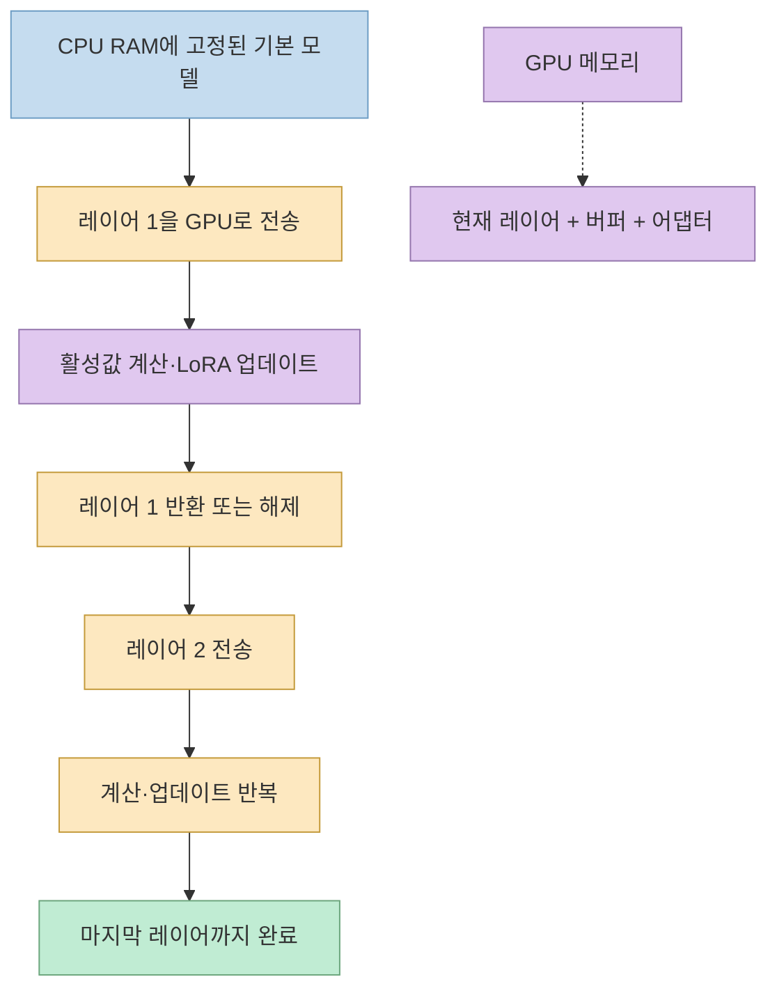
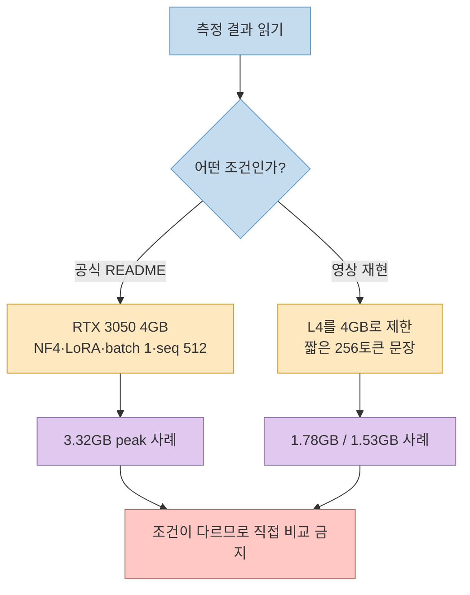
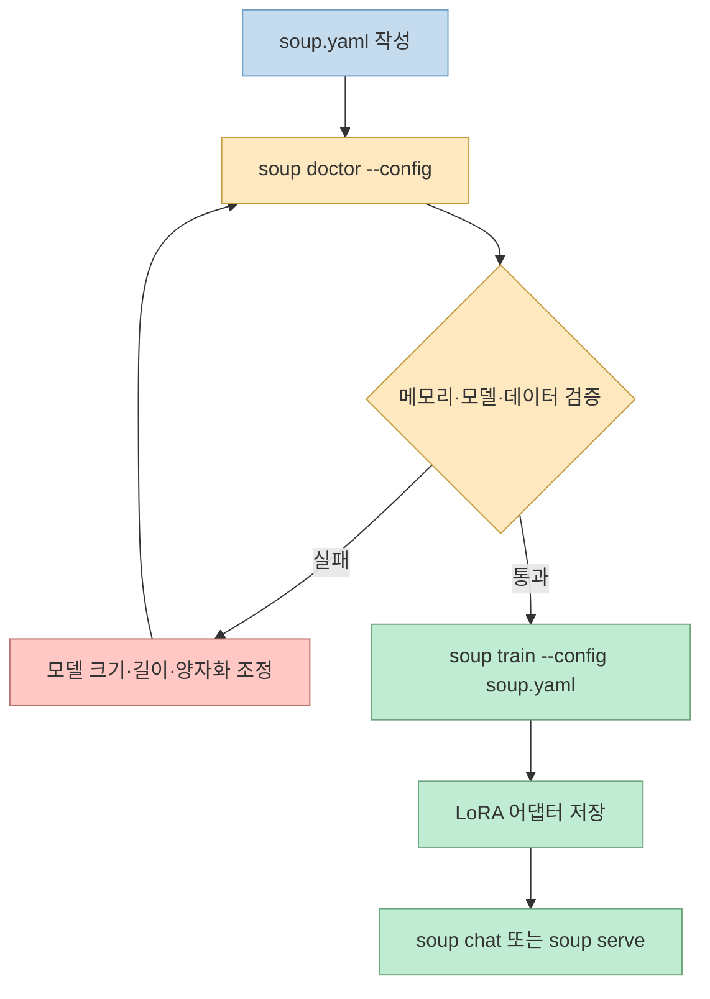
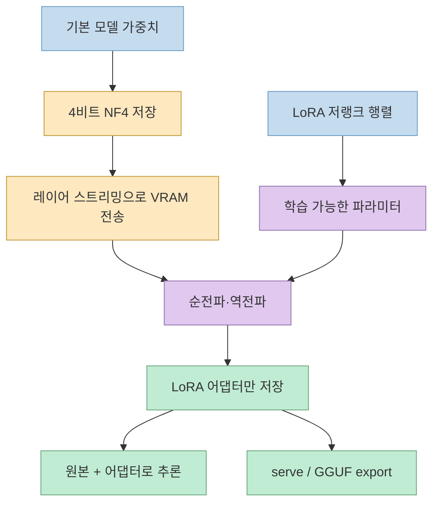
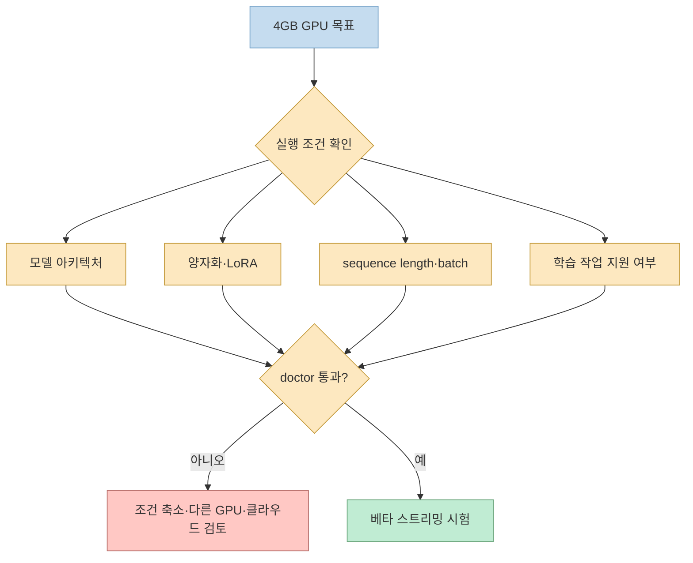

대규모 언어 모델을 직접 파인튜닝하려면 GPU 메모리, 양자화, LoRA, 데이터 형식과 학습 스크립트를 모두 준비해야 합니다. 영상에서 소개한 오픈소스 **Soup** 은 이 복잡한 과정을 YAML 설정과 `soup train` 명령으로 묶고, 레이어 스트리밍으로 모델 전체를 GPU에 올리지 않는 방식을 실험합니다. 덕분에 4GB 노트북 GPU에서 8B 모델의 QLoRA 학습을 시도할 수 있지만, “작은 GPU에서도 무료로 빠르게 학습된다”는 뜻과는 다릅니다.

<!--more-->

## Sources

- 원본 쇼츠: [노트북 GPU 4GB로 8B 모델 학습?](https://youtube.com/shorts/7SXe9P8Quc8)
- 공식 저장소: [MakazhanAlpamys/Soup](https://github.com/MakazhanAlpamys/Soup)
- 공식 문서: [trysoup.dev](https://trysoup.dev/)

영상의 설명·자동 자막을 기준으로 핵심 주장을 정리하고, 설치 명령·레이어 스트리밍 구조·측정 조건·현재 모델 제한은 공식 README와 Soup 문서를 교차 확인했습니다. 영상 설명의 실험 수치는 제작자가 제공한 기록이며, 모든 하드웨어에서 보장되는 수치가 아닙니다.

## Soup이 줄이는 파인튜닝 설정 비용

영상은 일반적인 LLM 파인튜닝이 클라우드 GPU 임대, 학습 스크립트 작성, 메모리 오류 디버깅을 요구한다고 설명합니다. Soup은 모델과 데이터 위치, 작업 종류를 YAML에 적고 `soup train`을 실행하는 흐름으로 배치 크기, GPU 감지, 양자화, LoRA 어댑터 설정을 자동화합니다. [쇼츠 0:10](https://youtu.be/7SXe9P8Quc8?t=10)

공식 Quick Start도 `pip install "soup-cli[train]"` → `soup init --template chat` → `soup train --config soup.yaml` 순서를 제시합니다. 결과물은 기본 모델을 다시 저장한 파일이 아니라 학습된 LoRA 어댑터이므로, 원본 모델과 어댑터를 함께 사용하거나 필요하면 GGUF 등으로 내보냅니다. [공식 Quick Start](https://trysoup.dev/#from-an-empty-folder-to-a-model-you-can-talk-to)



## 4GB GPU가 가능한 이유: 레이어 스트리밍

8B 모델을 일반적인 방식으로 학습하면 모델 가중치와 활성값, 옵티마이저·어댑터 버퍼가 한꺼번에 GPU 메모리를 사용합니다. 영상은 Soup이 모델을 통째로 올리는 대신 한 디코더 레이어를 GPU로 보내 학습하고, 다음 레이어로 교체한다고 설명합니다. [쇼츠 0:35](https://youtu.be/7SXe9P8Quc8?t=35)

공식 README는 이를 `stream_layers: true`인 베타 기능으로 명시합니다. 고정된 기본 모델은 레이어 단위로 GPU에 도착하므로 peak VRAM이 모델 전체 크기보다 “현재 레이어와 버퍼, 어댑터, 임베딩·헤드”의 합에 가까워집니다. 대신 매 레이어를 주고받는 전송 비용 때문에 메모리를 줄이는 대가로 속도가 느려질 수 있습니다. [레이어 스트리밍 공식 설명](https://github.com/MakazhanAlpamys/Soup#layer-streaming-beta)



레이어 스트리밍은 VRAM을 “없애는” 기술이 아닙니다. GPU에는 여전히 한 레이어와 학습에 필요한 임시 버퍼가 들어가며, CPU RAM과 PCIe 전송·계산 시간이 추가됩니다. 따라서 작은 GPU에서 실행 가능해지는 대신, 같은 학습을 더 빠르게 수행한다는 의미는 아닙니다.

## 공식 측정값과 영상 실험을 분리해서 읽기

공식 README의 한 측정은 Llama-3.1-8B-Instruct를 NF4와 LoRA로 학습할 때 RTX 3050 Laptop 4GB에서 peak 3.32GB를 기록했다고 설명합니다. README는 이 수치가 v0.72.2, batch 1, sequence 512 조건이며, 레이어 스트리밍은 베타이고 `stream_layers: true`로 명시적으로 켜야 한다고 적습니다. [공식 벤치마크](https://github.com/MakazhanAlpamys/Soup#layer-streaming-beta)

영상 설명에는 제작자가 Google Cloud L4를 4.00GB로 제한해 `proof-4gb` 노트북을 재현했고, 짧은 256토큰 문장에서 최고 1.78GB, 최신판 재실행에서 1.53GB를 측정했다고 적혀 있습니다. 이는 실제 4GB 노트북에서 측정한 공식 README 값과 조건이 다르므로, 두 값을 하나의 일반적인 성능 보장으로 합치면 안 됩니다. [영상 설명·실험 기록](https://youtube.com/shorts/7SXe9P8Quc8)



## 최소 설정 예시

공식 문서의 템플릿은 모델, 작업(`sft`), 데이터 경로와 형식, 학습 단계의 스트리밍·4비트·배치·LoRA를 YAML로 표현합니다. 아래 예시는 구조를 보여 주기 위한 것이며, 모델 접근 권한과 데이터 형식은 실행 전에 자신의 환경에 맞춰 확인해야 합니다. [공식 설정 예시](https://trysoup.dev/#step-2-write-the-config)

```yaml
base: meta-llama/Llama-3.1-8B-Instruct
task: sft

data:
  train: ./data/train.jsonl
  format: alpaca
  max_length: 512

training:
  stream_layers: true   # 베타, 메모리 절약
  quantization: 4bit   # NF4
  batch_size: 1
  lora:
    r: 16
    target_modules: [q_proj, v_proj]

output: ./output
```

실행 전에는 `soup doctor --config soup.yaml`로 설정과 하드웨어를 점검하는 편이 좋습니다. 공식 문서는 자동 batch 설정을 무조건 허용하지 않고, 레이어 스트리밍이 실제로 맞지 않는 실행을 사전 검사하도록 설계되어 있다고 설명합니다. [공식 레이어 스트리밍 설정](https://github.com/MakazhanAlpamys/Soup#layer-streaming-beta)



## LoRA·QLoRA와 메모리 절약의 관계

Soup의 4GB 사례는 단순히 모델을 4비트로 줄인 결과가 아닙니다. NF4 같은 4비트 양자화로 기본 가중치 저장 공간을 줄이고, LoRA로 전체 가중치를 업데이트하지 않으며, 레이어 스트리밍으로 GPU에 올라가는 기본 모델의 범위를 줄이는 조합입니다. 어느 한 요소만으로 공식 수치를 설명하면 안 됩니다. [쇼츠 39: 레이어 스트리밍 설명](https://youtu.be/7SXe9P8Quc8?t=39)

그 결과 학습되는 것은 작은 LoRA 어댑터이며, 원본 모델의 지식을 모두 다시 저장하는 완전한 체크포인트가 아닙니다. 배포할 때는 어댑터를 원본 모델과 함께 로드하거나, Soup의 `serve`·`export` 명령으로 OpenAI 호환 API나 GGUF 같은 형식으로 변환할 수 있습니다. [공식 출력·서빙 안내](https://trysoup.dev/#step-5-use-the-adapter)



## 현재 확인되는 제한사항

공식 문서에서 레이어 스트리밍은 여전히 BETA이며, 4GB 측정은 특정 모델·양자화·배치·시퀀스 길이에 묶여 있습니다. README는 8B 모델의 4GB 측정이 supervised fine-tuning 사례이며, 선호 최적화(DPO 등)는 추가 레이어 읽기 비용이 있고 4GB 카드에서 같은 속도를 주장하지 않는다고 명시합니다. [공식 제한·측정 조건](https://github.com/MakazhanAlpamys/Soup#layer-streaming-beta)

또한 4GB로 실행된다고 해서 모든 8B 모델과 데이터셋이 들어가는 것은 아닙니다. 긴 `max_length`, 큰 배치, 다른 아키텍처, 비지원 학습 작업은 메모리와 시간이 달라집니다. 공식 문서는 현재 레이어 스트리밍 경로에서 SFT·DPO·ORPO·SimPO·KTO·BCO·IPO를 지원하고 GRPO·PPO는 지원하지 않는다고 안내합니다. [지원 작업 목록](https://github.com/MakazhanAlpamys/Soup#layer-streaming-beta)



## 핵심 요약

- Soup은 YAML 한 개와 `soup train` 명령으로 LLM 파인튜닝의 설정·검증·출력 과정을 단순화합니다.
- 4GB 사례는 NF4 4비트 양자화, LoRA, 레이어 스트리밍을 함께 사용한 결과입니다.
- 레이어 스트리밍은 고정된 기본 모델을 한 레이어씩 GPU에 보내 VRAM을 줄이지만, 전송 비용 때문에 속도가 느려질 수 있습니다.
- 공식 README의 3.32GB 수치와 영상 제작자의 1.78GB·1.53GB 수치는 하드웨어와 토큰 길이가 다르므로 직접 비교하면 안 됩니다.
- `stream_layers: true`는 베타 기능이며, 모델·시퀀스 길이·학습 작업에 따라 실행 가능 여부가 달라집니다.
- 결과물은 LoRA 어댑터이며, 원본 모델과 함께 사용하거나 `serve`·`export`로 배포할 수 있습니다.

## 결론

Soup의 핵심은 비싼 GPU를 마법처럼 대체하는 것이 아니라, **메모리 사용량을 모델 전체가 아닌 현재 레이어 중심으로 재구성하는 것**입니다. 4GB GPU에서도 8B 모델 파인튜닝을 실험할 수 있다는 점은 로컬 AI의 진입 장벽을 낮추지만, 속도·데이터 길이·지원 작업·베타 상태를 함께 고려해야 합니다. 먼저 작은 데이터와 짧은 시퀀스로 `soup doctor`와 시험 학습을 실행하고, 측정 조건을 기록한 뒤 실제 프로젝트에 적용하는 것이 가장 안전한 접근입니다.
